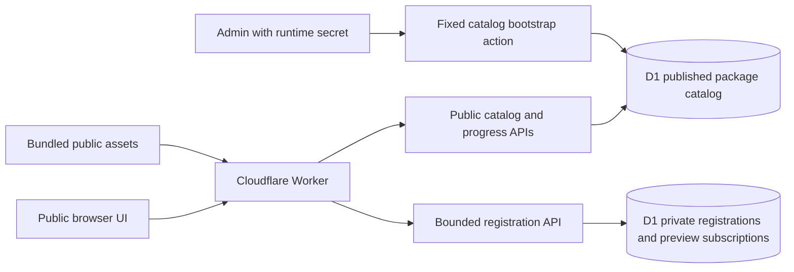

# Utility ERP — Platform Preview

A Philippine utility ERP preview with a public package catalog and registration backend. It explores modular utility operations while implementing a bounded onboarding slice. The broader billing, tenancy, staffing, and authentication architecture is documented as design work; it is not a production ERP implementation.

## Contributions and provenance

The preserved Sites source history contains 94 commits attributed to Lucky John. It records iterative preview, catalog, registration, and planning work. Concrete engineering artifacts include Worker API handlers, normalized Drizzle schema and migrations, immutable package versions, pinned registration receipts, synthetic workspace previews, and server-side validation. Human authorship versus AI-assisted implementation cannot be separated from repository evidence alone; publication rights require owner confirmation.

## Technology and structure

JavaScript ES modules, HTML/CSS, Cloudflare Workers and D1, Drizzle ORM/Kit, UUIDv7, esbuild, Wrangler, and Node's test runner. The executed checks used Node.js 24.22.3.

- `public/`: landing, registration, progress, and sample app UI.
- `worker/`: HTTP routing, catalog, registration, and progress handlers.
- `db/schema.js`, `drizzle/`: schema and versioned SQL migrations.
- `scripts/`: build, fixed catalog seeds, and integration checks.
- `tests/`: API validation, catalog boundaries, and sample-data checks.
- `docs/`: planned ERP architecture, ERD, standards, and earlier milestones.

## Architecture



Public catalog fields are bounded; no public registration listing endpoint exists. Registration receipts pin immutable package versions and module snapshots. The local build embeds public assets in a Worker bundle. No AI model, agent orchestrator, queue worker, or operational billing engine is connected in this checkout.

## Features

**Implemented and verified:** 21 tests pass; Worker bundle builds; the isolated D1 integration script passes migration, catalog immutability, concurrent registration retry, pinned receipt, Solar catalog, and withdrawn-offer checks. Input size/content-type/origin validation and missing-storage failures have test coverage. Sample workspaces are checked against package definitions.

**Implemented but not fully tested:** hosted onboarding with real traffic, operational rate limiting, and browser behavior in this review. Catalog administration is a fixed secret-protected bootstrap API, not a general administration console.

**Planned or experimental:** authenticated tenant operations, production billing, tariffs, payment providers, identity providers, staffing, and the broader ERP modules described in design documents. App previews and progress indicators are illustrative; their presence is not proof of implemented ERP modules.

## Installation and setup

Use Node.js 22.13+ (validation used 24.22.3).

```bash
npm ci
npm test
npm run build
npx wrangler d1 migrations apply DB --local --persist-to .wrangler/state
cp .env.example .dev.vars
npm run dev
```

Set `CATALOG_ADMIN_KEY` in ignored `.dev.vars`; use a new random value for any deployed environment. Wrangler reads `.dev.vars`, not `.env`. `wrangler.json` uses a placeholder database ID for local development. Open `http://127.0.0.1:4173`. Initialize catalog offers using the purpose-limited API described in `worker/catalog.js`; without seeded records the catalog is empty. No commercial prices are approved.

For schema changes only, run `npm run db:generate` and review generated migrations. Do not regenerate or edit already-published migrations. Sites identity and bindings are retained in `.openai/hosting.json`; cloning does not provision hosted infrastructure or grant production database access.

Run the isolated integration check after building:

```bash
node scripts/check-solar-integration.mjs
```

It creates and disposes its own Miniflare D1 runtime. `scripts/check-catalog-integration.mjs` targets only `127.0.0.1:4173`, mutates local synthetic records, and expects the documented test-only admin fixture. Never target production for either check.

The portfolio dependency refresh and pinned development-tool overrides are documented in `PORTFOLIO_REVIEW.md`; the resulting npm audit reports zero vulnerabilities.

## Engineering considerations

Registration uses bounded JSON, explicit validation, a same-origin policy, a honeypot, a database rate bucket, idempotency keys, request fingerprints, and atomic D1 batches. Catalog versions are immutable and availability is checked during signup. Missing storage returns failure rather than fake success. Public assets have CSP and content-type protections. These measures do not establish production abuse resistance, full tenant isolation, regulatory compliance, or load-tested capacity. The preview voucher `123456` is intentionally public and is not a production credential.

## Current status and demo

Development preview; the connected Sites metadata reports a live public preview at [Utility ERP](https://utility-erp-foundation-preview.lj-faderon.chatgpt.site). This review did not perform production writes or certify the live system. No production deployment of the full ERP is claimed. Genuine screenshots were not available locally.

## Known limitations

No real ERP login, verified email, payment, paid subscription activation, or AI agent integration. The hard-coded registration origin permits the original hosted preview and localhost; another host needs an explicit origin configuration change. Earlier `docs/hosted-preview.md` describes an obsolete static phase; use the source and this README for the current bounded backend. Production customer data and runtime databases must remain outside Git.
