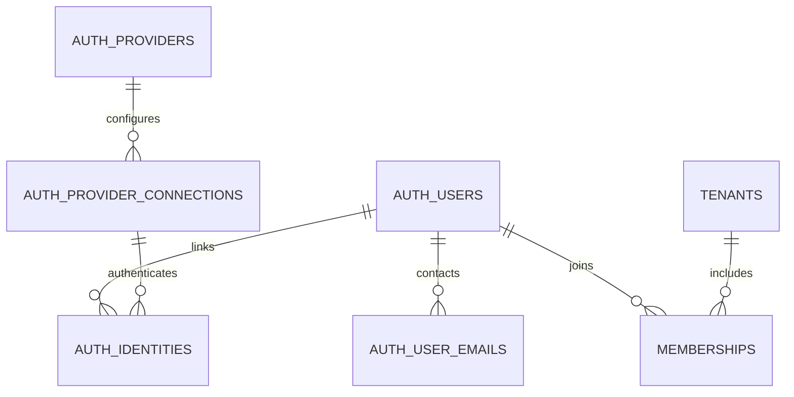

# Phase 1 — Platform signup and sign-in identities

Requested providers: Apple, Google, Facebook and Microsoft. Design only: no API credentials, provider integration, live signup or sign-in is implemented. Future UI initially shows disabled provider placeholders labeled “Coming soon”.

## Normalized global identity model

| Physical table | Key fields and responsibility |
| --- | --- |
| auth_users | id UUIDv7 PK, status, created_at/updated_at; stable internal user identity used by memberships and actor references |
| auth_providers | id UUIDv7 PK, code unique (apple/google/facebook/microsoft), display_name, display_order, is_enabled default false; global provider directory |
| auth_provider_connections | id UUIDv7 PK, auth_provider_id FK, connection_code unique, protocol, configured_issuer where applicable, client_id optional, configuration_status, is_enabled default false; integration configuration without credentials |
| auth_identities | id UUIDv7 PK, auth_user_id FK, auth_provider_connection_id FK, authority_namespace, provider_subject, linked_at, last_sign_in_at, revoked_at; unique(connection, namespace, subject) |
| auth_user_emails | id UUIDv7 PK, auth_user_id FK, email, normalized_email, verified_at, is_primary; per-user uniqueness and at most one active primary email |

Move issuer/subject out of the earlier conceptual auth_user entity into auth_identities. One user can link several sign-in identities without duplicating memberships or business people. Emails are contact attributes, not identity keys; do not enforce global email uniqueness for social accounts or use an email match to auto-link users.

Authority namespace represents the validated provider security authority; validate and canonicalize it server-side. For OIDC, bind issuer/subject to the configured client connection and verify audience. For provider APIs without OIDC, use the provider's documented verified app-scoped identifier and namespace. Never assume all providers support the same protocol. Reserve identity tuples on revocation to prevent silent reassignment to another user. Provider migrations or subject transfer require explicit reviewed mapping.

Microsoft organization/account identifiers do not identify a SaaS tenant and must not create membership implicitly. Apple private-relay addresses and provider emails that are missing, changed or unverified must be supported.

## Future flows

- Signup: a successfully verified provider identity creates an auth_user and auth_identity transactionally, then enters onboarding. No utility access exists until a membership is separately created through authorized tenant creation or invitation acceptance.
- Sign-in: resolve the verified identity to its internal auth_user, check account and identity status, then present authorized memberships. Provider authentication alone never grants a paid module or client assignment.
- Link account: require an existing authenticated user, recent reauthentication and a verified provider callback bound to that session. If identity belongs to another user, block linking; use a separate audited recovery/merge process.
- Unlink: require reauthentication, revoke relevant sessions and preserve audit attribution. Do not remove the last usable sign-in/recovery method.
- Invitations: bind acceptance to an authorized invitation and verified intended recipient policy. A same-email match alone is not proof of authority.

Future implementation must validate OAuth state/PKCE and OIDC nonce/signature/issuer/audience/expiry where applicable, use secure server-managed sessions, and rate-limit callbacks and signup. No browser-supplied provider subject or email may establish identity. Keep client secrets in a secret manager; reference them via configuration, never store them as public catalog fields. Do not retain provider access/refresh tokens unless a separately authorized integration needs them.

## Placeholder UI contract

On future signup and sign-in screens, show “Continue with Apple”, “Continue with Google”, “Continue with Facebook” and “Continue with Microsoft”, each disabled with visible “Coming soon” text. Explain: “Provider sign-in is not connected yet.” Provide accessible text labels; do not rely on logos or color alone.

No redirect, simulated session, account creation or successful sign-in occurs when placeholders are displayed. No secrets or fake production IDs are needed. Keep provider enablement distinct from mere directory presence. A provider becomes actionable only after its connection is configured, tested and enabled server-side. Tenant signup is separate from platform authentication. Do not add a password flow unless separately designed.

## Phase placement and verification

Phase 1 establishes this model. Phase 2 can create disabled provider seed records, placeholder screens and an authentication adapter boundary. Live integrations follow only when real provider application registrations and callback configuration exist.

Verify multiple identities resolve to one user; duplicate verified tuples cannot create two users under concurrent signup; email matches do not auto-link; disabled providers cannot start authentication; revoked identities cannot sign in; no social callback grants tenant membership, staff assignment or entitlement by itself. Verify account status and session revocation separately from business-party soft deletion. Retain identity records according to the security/privacy policy rather than generic cascading deletion.
