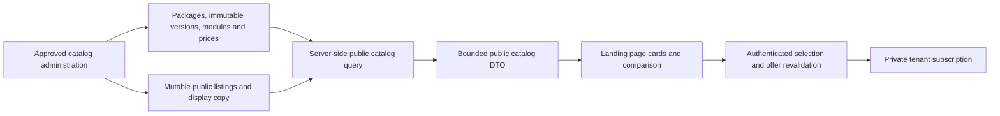

# Phase 1 — Landing page and dynamic package catalog

Design deliverable only. No website, database, subscription checkout or hosting has been implemented. Product name, package names, prices and availability require business approval. This extends the [ERD](phase-1-erd.md), [database standards](database-standards.md) and [backend design](backend-design.md).

## Positioning and audience

Position the product as utility operations software with optional contracted staffing. Start with Philippine electric distribution utilities and their owners, operations managers, finance teams and service providers. Water and internet are roadmap markets; the landing page must label them as planned rather than currently supported.

The initial commercial conversion is a product demonstration or implementation discussion. Do not advertise a free trial, instant deployment, staffed service availability, compliance certification, customer count or savings percentage without an actual offering or evidence. Modules in development must be marked planned or preview rather than presented as delivered functionality.

Working descriptor: **Utility ERP**. Suggested title: **Utility ERP | Software and managed operations for distribution utilities**. Suggested description: **Connect customer accounts, meter readings, billing and field work. Choose a software package and explore contracted operational support for your utility.**

## Page structure and draft copy

| Section | Draft content and purpose |
| --- | --- |
| Header | Working wordmark; Product, Packages, Managed staffing, FAQ; Sign in; primary action “Request a demo” |
| Hero | Eyebrow: “For Philippine distribution utilities”. Heading: “Bring your utility operations together.” Body: “Connect customer accounts, meter readings, billing and collections in one platform. Choose the modules you need and explore contracted staff to support your operations.” Primary action: “Request a demo”. Secondary: “Explore packages”. Prelaunch label: “In development · Pilot discussions welcome”, while that remains true |
| Workflow | Heading: “Follow the service from connection to collection.” Four steps: “Register customers and connections”; “Capture and review readings”; “Prepare and approve bills”; “Record payments and track balances”. Clearly caption any interface mockup “Product concept” until real screens exist |
| Modules | Heading: “Build around the work your utility needs.” Customer and service management; Metering and billing; Collections and reporting; Field operations. Each card gets a status label sourced from the approved product content, distinguishing planned modules |
| Packages | Heading: “Choose a package for your operation.” Body: “Compare included modules, capacity and billing terms.” Render catalog-driven cards and comparison rows. If no published offers exist, use the empty state below rather than hard-coded paid plans |
| Managed staffing | Heading: “Software for your team. Operational support when you need it.” Body: “Operate with your own staff, an external service provider, or a combination of both. Approved workers receive scoped access to your utility workspace, with assignment dates and an audit trail.” Action: “Discuss managed operations”. Supporting line: “Staffing scope, availability and fees are agreed separately.” |
| Access and accountability | Heading: “Keep access tied to responsibility.” Three concrete concepts: separate utility workspaces; role-based approval; time-bounded provider assignments. During development use “Designed for…” wording and avoid implying security verification has already passed |
| Getting started | “Discuss your operation” → “Confirm modules and service scope” → “Plan a pilot and data migration”. No unsupported setup-duration promise |
| FAQ | Questions and draft answers below |
| Final conversion | Heading: “Plan the next step for your utility.” Body: “Tell us about your service area, billing process and staffing needs.” Action: “Request a demo” |
| Footer | Product status, Contact, Privacy, Terms, Sign in; actual legal identity/contact details supplied before public launch |

FAQ draft:

- **Can we use our own employees?** Yes. The design supports internal staff, approved external workers, or both.
- **Can we operate without internal employees?** The model supports contracted operations. Your utility still appoints an accountable owner or authorized representative, and the service scope is agreed with the provider.
- **Does a software package include staff?** Only where a written offer explicitly includes staffing. Otherwise software subscriptions and staffing contracts are separate.
- **Can packages change?** Package changes follow the agreed subscription terms. A newly published package does not silently replace an existing customer's contracted version.
- **Does this support Philippine electric billing?** Philippine electric distribution is the first planned implementation. Actual tariff and invoice configuration must be validated for the participating utility before live billing.
- **What about water and internet utilities?** They are planned extensions; current availability must be stated from the approved product roadmap.

## Visual and interaction direction

Signup/sign-in destinations follow [authentication-design.md](authentication-design.md): Apple, Google, Facebook and Microsoft buttons are disabled “Coming soon” placeholders until integrations exist. Do not simulate authentication or create sessions from these controls.

Use a calm operational appearance: deep navy text, light neutral backgrounds, teal primary actions, and amber reserved for attention states. Pair a clear system sans-serif with a tabular number style for prices and comparison values; no external font dependency is required. Establish color tokens only after checking actual contrast values.

Hero uses a wide copy column and a simplified connection-to-payment workflow illustration. Avoid stock power-line photography as the main explanation. Use actual application screenshots only when available, with synthetic data. Give generous space to module names and limits; buyers should be able to compare without opening every card.

Desktop layout: bounded approximately 1200px content width, three package cards when the catalog has three offers; adapt grid to the actual count. Tablet: two columns. Mobile: single-column cards, collapsible navigation, no horizontal page scroll. A comparison table may use an accessible scroll region on narrow screens, with a visible cue. Do not force annual pricing or hide the full payable amount.

```text
[Utility ERP]  Product  Packages  Managed staffing  FAQ   [Sign in] [Request a demo]

[For Philippine distribution utilities]
Bring your utility operations together.     [Connection → Reading → Bill → Payment]
[Request a demo] [Explore packages]          [Product concept / development label]

[Four-step workflow]
[Module overview and availability labels]

Choose a package for your operation.
[Currency: PHP] [Monthly | Annual, only when offered]
[Package from DB] [Package from DB] [Package from DB]
[Compare modules, limits, terms]

[Own staff / contracted support / mixed operation]
[Discuss managed operations]
[Access and accountability] [Getting started] [FAQ]
[Request a demo form or route]
[Privacy] [Terms] [Contact]
```

Target WCAG 2.2 AA: semantic landmarks and headings, skip link, visible keyboard focus, contrast-checked controls, explicit form labels, error summaries linked to fields, sufficiently sized targets, and reduced-motion support. Price interval controls use buttons with a clear selected state or radio semantics. Never rely on color/checkmarks alone for module inclusion; use “Included”, “Not included” and specific limits. Dynamic status messages use a restrained live region. Locale-aware PHP display uses en-PH formatting, while raw amounts remain decimal strings.

## Dynamic data: catalog versus subscriptions

The public page reads the **offer catalog**, not tenant subscriptions:



Physical table relationships:

`packages → package_versions → package_modules → modules`

`package_versions → package_prices ← subscriptions`

A subscription records a tenant's purchase of a specific price and its immutable package version. Public pricing uses published package versions and prices available for sale. It must never query `subscriptions` to assemble cards, count subscribers, infer customer activity or expose negotiated pricing. `platform_invoices`, `usage_records`, `service_contracts` and utility data are also excluded from the public query.

Core, Billing and Operations remain proposed package labels, not approved offers. All module inclusion, limits, prices, currency and intervals on an actual published page come from approved records. Do not keep a second hard-coded feature matrix in frontend code.

### Proposed presentation extension to the ERD

Keep commercial facts separate from editable marketing presentation. These new logical tables are Phase 1 proposals to incorporate into implementation planning:

| Table | Proposed fields and rules |
| --- | --- |
| package_listings | `id`, `package_version_id`, `slug`, `market_code`, `is_public`, `sales_status` (inquiry_only/open/closed), `display_order`, `is_featured`, `visible_from`, `visible_until`, `row_version`, shared actor/timestamp fields. One active listing per version/market. It selects a published immutable version, never edits its contents |
| package_listing_contents | `package_listing_id`, `locale`, `headline`, `summary`, `audience_label`, `badge_text`, `is_public`; unique listing/locale |
| package_listing_prices | `package_listing_id`, `package_price_id`, `is_public`, `sales_status`, `display_order`. Composite validation requires the price belong to the listing's version. This is the explicit public sale allowlist, excluding private negotiated prices |
| module_contents | `module_id`, `locale`, `display_name`, `short_description`, `display_order`, `availability_status` (planned/preview/available). Labels cannot override actual package inclusions |
| package_price_disclosures | `package_price_id`, `locale`, `tax_display_policy`, `tax_note`, `setup_fee_note`, `renewal_note`, `minimum_term_note`; ensure commercial disclosures match actual agreed terms rather than inventing fee fields in marketing copy |
| catalog_revisions | Market/locale revision, changed timestamp; supports cache keys and ETags, not entitlement authorization |

Keep market/publication/sale state on `package_listings`, and translated copy and locale on `package_listing_contents`. The public query requires both the listing and localized copy to be public. Use unique `(package_listing_id, locale)` for content. A partial active uniqueness policy must prevent multiple public listings for the same package/market when simultaneous versions are not intended.

Currency, amount and billing interval remain on immutable `package_prices`; module inclusion stays on `package_modules`; quantities stay on `package_limits`. Published price changes create new price rows. Published package changes create new version rows. Changing a listing's copy, ordering, featured flag or sale visibility does not alter existing subscriptions. Retirement must withdraw public sale without destroying a subscribed package or price.

Editable content is plain text or a sanitized limited format; reject arbitrary scripts, raw HTML and unvalidated CTA URLs. Button action is derived from approved sale state. Featured means an explicit editorial choice, not an invented popularity claim.

### Public read API

Proposed route: `GET /api/v1/public/package-catalog?market=PH&locale=en-PH&currency=PHP&interval=monthly`.

Allowlist query parameters and supported values. Currency selection does not perform exchange-rate conversion. Monthly/annual controls appear only for intervals actually available. Annual prices show the full annual payable amount; a computed monthly equivalent is optional and explicitly labeled. Advertise a saving only when calculated from comparable approved prices and terms.

Return bounded public fields: catalog revision, generated timestamp, market, locale, currency, interval, listing ID/slug/display copy/order/featured flag, published package version identifier, included module labels and limits, selected public price ID/decimal amount/interval/currency, disclosures, sales state and derived CTA. Exclude tenant IDs, actor IDs, internal costs, provider worker profiles and draft catalog records. Set a maximum result count and field lengths; no arbitrary nested expansion. Return null price plus “Discuss pricing” only for an explicitly approved inquiry-only offer, never as a fallback for corrupt paid offers.

Server query requirements:

1. Query through a dedicated read-only catalog repository/view with column-level allowlists; anonymous clients never receive database credentials or direct table access.
2. Require published package version; public active listing; public localized content; public matching listing-price allowlist; non-deleted eligible mutable records; matching market/currency/interval; valid price dates and visibility dates. The server clock determines `[start, end)` eligibility.
3. Separate visibility from purchase eligibility: inquiry-only records can be public, closed records may remain informational with no purchase action. Never use `is_public` alone as authorization to subscribe.
4. Verify module dependencies and required disclosures during publication. An invalid offering is excluded and alerted to administrators rather than silently repaired by the frontend.
5. Resolve joins without duplicate cards or repeated modules; use deterministic order `(display_order, id)`. Return the correct localized content or a documented locale fallback; never accidentally mix price disclosures between markets.

Use server-side rendering for initial discovery and SEO. Browser interval changes can fetch the same public API. A cache key includes market, locale, currency, interval and catalog revision; no tenant-specific data enters a shared cache. Publishing, retiring, editing presentation or changing eligible price listings increments the revision and invalidates affected entries. Set a short maximum TTL, capped at the next visibility/price boundary, and use ETags. If invalidation fails, TTL limits stale display; selection always revalidates without trusting the page cache.

Do not use a stale public price as a binding purchase instruction. No private portal response may share the anonymous catalog cache.

## Card and conversion behavior

Cards show package display name, audience, summary, price and complete billing period, required tax/setup/minimum-term disclosures, included modules and capacity limits, optional add-on notice, and CTA. A consistent disclaimer explains that managed staffing is separate unless explicitly included in an approved offer.

Current prelaunch mode: “Discuss this package” opens a demo/inquiry flow with listing/price IDs as context. No subscription or charge is created. If an offer has no approved amount, show its deliberate inquiry-only state. Do not render “₱0”, “Free”, “Unlimited” or “Start now” as a missing-data default.

Future subscription mode:

1. Visitor selects an eligible package/price; store only a non-authoritative selection reference.
2. Require authentication and selection or creation of the utility tenant. Validate authorized subscription-management permission for that tenant; no user-selected tenant ID is trusted.
3. Server reloads current offer eligibility, immutable price/version and dependencies; presents the actual term, taxes, fees and staffing distinction for confirmation. Changed/unavailable offers require a refreshed confirmation.
4. Accept an idempotent command carrying server-validated references and terms acceptance; never accept a browser-calculated amount. Create a pending order/subscription only through the actual commerce workflow.
5. Activate entitlements according to the implemented payment/contract policy. Until payments are integrated, use an explicit inquiry/manual agreement flow; do not show successful payment or live activation.

Demo form: name, work email, utility/organization name, role, optional customer-count range, and optional staffing interest. Show purpose/privacy information and separate optional marketing consent from the requested reply. Add accessible validation, throttling and spam controls. Report success only after the configured backend actually persists the request; no simulated submission. Sending messages or connecting CRM/email is a later integration task.

## Loading and failure states

| State | User-facing behavior |
| --- | --- |
| Initial loading | Server-render public content; reserve card space with restrained skeletons if catalog fetching remains pending; announce loading once |
| No published packages | “Packages are being prepared. Contact us to discuss your utility's needs.” Show inquiry CTA, no fabricated tiers |
| Unsupported currency/interval | Explain “No published offers for this selection”; offer only actual available alternatives |
| Catalog error | “We couldn't load packages. Please retry or request a demo.” Preserve the rest of the landing page; do not fall back to invented prices |
| Price becomes unavailable | Keep the buyer's context, refresh choices and explain that the selected offer is no longer available before any confirmation |
| Form error | Preserve input, show field-level and summary errors, allow safe retry with idempotency |
| Success | Distinguish “Request received” from “Subscription active”; do not imply staff have been assigned |

## Acceptance criteria and implementation handoff

- Publishing an approved catalog record changes landing cards without a frontend deployment; changing module inclusion requires a new package version.
- Drafts, deleted/retired sale records, future/expired prices and negotiated private prices never leak publicly.
- Public requests cannot return tenant subscriptions, subscriber counts, usage, identities, contracts or billing records.
- Copy/order/featured edits do not mutate existing subscribers' terms; cache invalidation and date-boundary expiry are verified.
- Displayed prices, intervals, disclosures, modules and limits match the selected published version; zero/unknown/unlimited are not conflated.
- Unauthenticated selection cannot activate a tenant subscription, and authenticated users cannot purchase for another tenant without authority.
- Keyboard, mobile layout, error states and locale/currency presentation are checked; page has one H1 and meaningful title/description.
- No fake testimonials, certification seals, invented results, automatic staffing promises or unimplemented checkout success states are present.

Phase 2 implements the public catalog model/read endpoint and landing skeleton when implementation is authorized. Later commercial and staffing phases add real subscription checkout and service-contract flows. Brand identity, published offers, legal details, supported contact channel and approved product availability remain inputs for launch.
