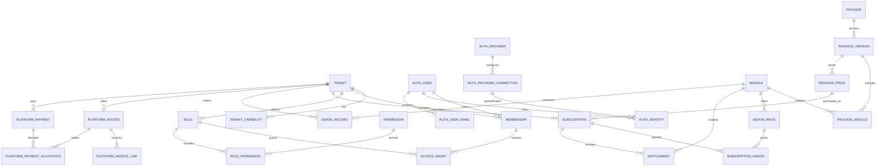
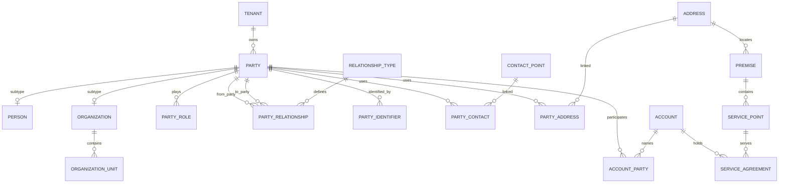
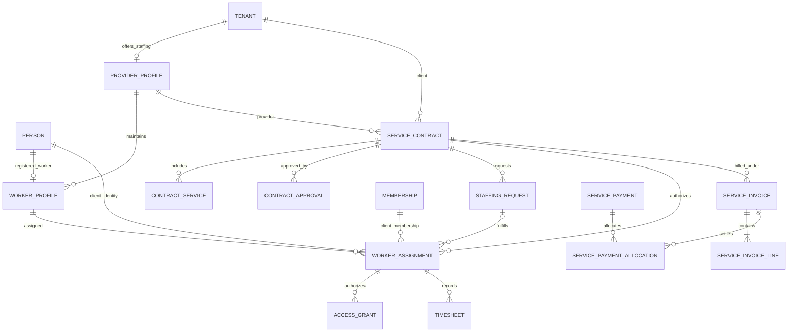
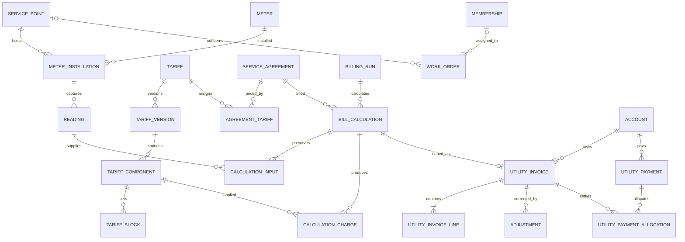

# Phase 1 — Top-level database ERD v1

Logical design for Philippine electric-distribution ERP SaaS, module subscriptions and contracted staffing. This establishes the Phase 2 schema baseline; it is not an executed migration. Diagrams are split by domain for readability and share the same entity names.

## Boundaries and key conventions

Physical tables use plural snake_case names, singular foreign keys and UUIDv7 entity IDs. See [database-standards.md](database-standards.md) for common columns and soft-delete rules. Diagram labels remain logical entity names.

- `platform`: global catalog, authentication, tenant registry and SaaS commercial records. No automatic access to customer operations.
- `tenant`: private business identities, permissions and utility operations. Tenant can have utility and/or provider capabilities; these are not mutually exclusive tenant types.
- `collaboration`: explicitly shared contracts and assignments between identified client and provider tenants. Private worker employment records remain in the provider tenant.
- All IDs are UUIDs. Tenant-owned entities use primary key `(tenant_id, id)`; tenant-local references are composite foreign keys. Person and organization use `(tenant_id, party_id)` as their primary and party foreign key.
- Diagram edges show logical cardinality; composite keys, optional references and lifecycle constraints in this document govern implementation. Supporting columns and audit timestamps are omitted from diagrams.
- Dates use start-inclusive/end-exclusive ranges. Currency is explicit; initial utility defaults are PHP and Asia/Manila.

## 1. Platform, subscriptions and access

| Entity | Key fields and rules |
| --- | --- |
| tenant | id PK, slug unique, operator_party_id, status, default_currency, timezone; deferred operator FK to same-tenant organization |
| tenant_capability | tenant_id + capability_code PK; utility/provider capabilities can coexist |
| auth_user | id PK; stable global account; provider identifiers live in auth_identities; no global business-person profile |
| auth_provider / auth_provider_connection / auth_identity | Disabled provider directory, integration configuration and per-user provider identities; see authentication design |
| membership | tenant_id + id PK, auth_user_id FK, person_party_id optional FK, status; unique tenant/user |
| role / permission / role_permission | Tenant-local roles; platform permission catalog with module_id; junction enforces role-permission uniqueness |
| access_grant | tenant_id + id PK, membership_id, role_id, source_kind, assignment_id optional, valid range; direct and assignment-derived grants remain distinct |
| package / package_version | Global IDs; package code unique; unique package/version; published versions immutable |
| package_module | package_version_id + module_id PK; included capability |
| module_dependency | module_id + required_module_id PK; reject dependency cycles |
| package_limit | package_version_id + module_id + metric_code PK; typed numeric limits, no repeated limit columns |
| package_price | id PK, package_version_id FK, currency, interval, amount, effective range; published prices immutable |
| subscription | id PK, tenant_id FK, package_price_id FK, status and term; derive package version from price; one base subscription in force per tenant at a time |
| addon_price / subscription_addon | Published module/quantity price; dated subscription purchase; validate dependencies |
| entitlement | id PK, tenant_id, subscription_id, module_id, valid range; derived access projection, rebuildable from subscription and add-ons |
| usage_record | id PK, tenant_id, module_id, metric_code, quantity, occurred_at, idempotency_key; unique tenant/source key |
| platform_invoice / line | Platform-owned SaaS receivable, tenant debtor, immutable issued lines referencing subscription/add-on sources where applicable |
| platform_payment / allocation | Tenant payer, currency, external reference; invoice/payment junction supports partial and combined payments |

`entitlement` is an intentional materialized access projection, not a second editable source of commercial truth. Resolve quantity limits into a child entitlement_limit table. Package visibility does not grant permissions. Access requires an active membership, applicable unexpired grants, scoped permission and tenant entitlement.

Scope access grants through typed grant_account_scope, grant_unit_scope and grant_work_order_scope tables as needed. Do not put an unenforced generic resource ID in a permission row. Each reference must stay in the grant's tenant. Broad tenant-wide grants must be explicit.

## 2. People, companies and customer accounts

Apple, Google, Facebook and Microsoft signup/sign-in are planned through the normalized [authentication model](authentication-design.md). Multiple provider identities may link to one global user. Initial UI buttons remain disabled placeholders; authentication does not automatically grant membership.

Each party must have exactly one matching person/organization subtype, enforced with deferred database validation. A customer or employee is a role of a party. Party relationships carry type, direction and validity; they do not confer application access. Relationship types specify valid endpoint kinds. Hierarchy relationships must prevent cycles.

Account-party roles identify holder, payer and authorized contact with effective dates. A bill is charged to an account; the billed party/address is snapshotted when issued. A premise is independent of its occupants. Service agreements preserve the history of which account receives service at each connection.

See [normalized-data-model.md](normalized-data-model.md) for identity fields and normalization rules.

## 3. Staffing contracts and delegated access

| Entity | Keys and boundary rules |
| --- | --- |
| provider_profile | tenant_id PK/FK; provider service status |
| worker_profile | provider_tenant_id + id PK; person_party_id and membership_id reference that provider tenant; required login membership for digitally assigned workers |
| service_contract | id PK, client_tenant_id, provider_tenant_id, term, status; client differs from provider; unique composite tuple for child FKs |
| contract_service | contract_id + id PK, service code, agreed scope and rate terms |
| contract_approval | contract_id + id PK, approving tenant/membership, side, timestamp; validate signer belongs to designated side and has authority |
| staffing_request | id PK, contract_id, client_tenant_id, provider_tenant_id, requested role/capacity/dates |
| worker_assignment | id PK, contract_id, client_tenant_id, provider_tenant_id, worker_id, client_membership_id, client_person_party_id, optional request_id, term, status |
| timesheet | assignment_id + id PK, work date, quantity, submission and approval status; controlled shared fields only |
| service_invoice / line | Provider-issued staffing invoice under one contract; parties and terms snapshotted at issue |
| service_payment / allocation | Same contract boundary; payment-to-invoice allocation, currency and over-allocation checks |

Assignments use composite foreign keys to the contract's exact client/provider tuple, the provider worker and the client membership/person. Optional request references must match the same contract. The authenticated user behind the provider worker membership and client membership must match; verify transactionally on assignment creation and membership changes.

A client-local person is the external identity: no extra duplicate client_external_identity table is needed. Assignment-derived access_grant replaces the earlier conceptual assignment_access table. It references the assignment and the same client membership. Restrict role scopes and grant duration to the approved assignment; revocation must be checked at authorization time, including worker jobs, not only by a scheduled cleanup.

Collaboration rows have explicit two-party visibility policies; they are not covered by a permissive generic tenant_id filter. Provider-private qualifications, payroll and identity documents remain private. A shared timesheet does not expose unrelated utility records. Provider managers need separate client assignments to perform utility work.

Contracts can exist without individual assignments; they grant no operational access. A utility with no employees still has a designated accountable representative and approved client-side authority. No worker may self-approve their assignment or the bill they prepared, even across multiple memberships.

## 4. Meter-to-cash operations

Calculations and their input/charge rows are versioned drafts. Issuance selects one approved calculation; prevent duplicate issued normal bills for the same agreement/period/type. Preserve all applied tariff versions through charge references, including periods spanning tariff changes. Store tax/rounding results and invoice snapshots. Detailed proration, demand and time-of-use entities are deferred until the utility's actual tariff is established.

All operational records are client tenant-owned, including records created by external workers. Reads, writes and job processing use that tenant context. Installation periods and service agreements enforce relevant no-overlap rules. Do not subtract readings across meter replacements.

The diagram models invoices for one agreement per period initially. Support for consolidated multi-agreement invoices requires an invoice-to-calculation junction before implementation if selected.

## 5. Audit and supporting infrastructure

Tenant-scoped audit_event records actor auth_user_id, membership_id, optional assignment_id, action, entity reference and timestamp. Actor references must match client context. Global administrative actions use a separate platform_audit_event stream. Job/outbox records include tenant and idempotency keys; delegated jobs also carry assignment context and recheck authority at execution.

Documents use private storage metadata with tenant ownership and explicit collaboration sharing where needed. Never infer shared access from a provider/client relationship alone. Protect sensitive values in audit payloads.

## Phase 2 migration order and verification

The [landing-page catalog design](landing-page-design.md) extends the public catalog with package_listings, localized package_listing_contents, explicit package_listing_prices allowlists, module_contents, price disclosures and catalog revisions. These are platform catalog records, not tenant subscription records. Mutable marketing/sale visibility stays separate from immutable purchased versions and prices; the public endpoint must not expose subscriptions. See that design for the proposed fields and purchase revalidation boundary.

1. Global tenant registry, identity and permission/catalog tables.
2. Tenant parties/subtypes; deferred tenant/operator organization linkage; roles and memberships.
3. Package prices, subscriptions, entitlements and commercial ledgers.
4. Provider workers, contracts, approvals, assignments and access grants.
5. Accounts, premises, agreements, meters, tariffs and billing/collections.
6. Audit, jobs, storage metadata and row-level policies alongside the owning modules.

Verify tenant-isolating foreign keys; subtype completeness; immutable published prices/packages and issued documents; assignment user/tenant consistency; contract-side visibility; package and role authorization; interval validity; allocation concurrency; and the externally staffed billing scenario.

Open business decisions remain package prices/limits, subscription grace/proration policies, staffing commercial terms, account-holder rules, the pilot utility and approved tariff components. These do not require changing the top-level isolation boundaries.
