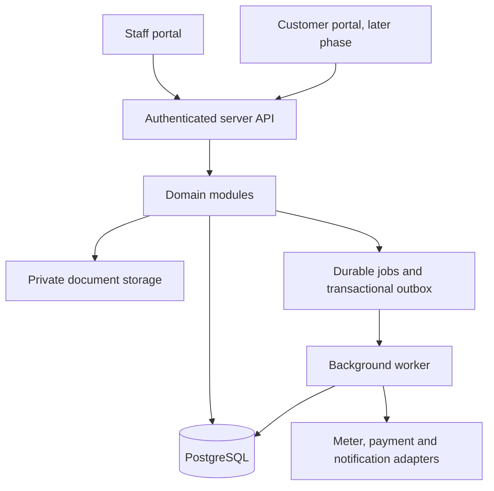

# Phase 1 — Electric distribution planning baseline

## Goal

Build a SaaS platform that lets a distribution utility manage customer accounts, service connections, meters, readings, invoices, and collections. Prove a complete billing cycle before adding production integrations. Later utility types can reuse shared capabilities while supplying their own service and billing modules.

## Confirmed scope and assumptions

Confirmed: electric distribution first; Philippines; architecture and phased implementation first; development in the ChatGPT workspace. Database normalization includes people, companies and their relationships. Default currency is PHP and utility timezone is Asia/Manila; store instants in UTC.

Provisional defaults: monthly billing, one currency per utility, manual or CSV readings, recorded payments, synthetic customers, and demonstration tariffs. These are implementation defaults rather than regulatory requirements.

Open decisions:

| Decision | Needed before |
| --- | --- |
| Specific distribution utility, service territory and applicable regulatory approvals | Regulatory configuration and pilot approval |
| Billing dates and invoice numbering | Billing configuration |
| Approved tariff schedule, taxes, rounding and proration | Real billing acceptance |
| Tenant count, customers per utility, reading volume | Capacity and hosting design |
| Required payment, meter, accounting and GIS integrations | Integration implementation |
| Data residency, retention, recovery objectives | Production deployment |

No live disconnection, electrical switching, or remote meter commands are part of the prototype.

## MVP boundaries

The platform also supports module packages and contracted external staffing. See [subscriptions-and-staffing.md](subscriptions-and-staffing.md) for the logical design and phased delivery. Build entitlement and assignment-aware access foundations in Phase 2; stage full commercial and staffing workflows after the core billing prototype.

Include tenant administration; staff roles; customer accounts; premises and service points; service agreements; meter installations and replacements; readings with validation; effective-dated tariffs; billing review and approval; invoices; adjustments; payments and allocations; balances; and basic operational reports.

Defer full general ledger, payroll, procurement, advanced GIS, outage management, smart-meter infrastructure, demand/time-of-use billing, online payment processing, and automated field control. Confirm the first utility's tariff requirements before relying on the demonstration billing model.

## Application architecture

Use a TypeScript modular application with Next.js portals and server endpoints, PostgreSQL, object storage for documents, and a background worker for imports and billing batches. Docker Compose is the proposed development setup; verify workspace runtime support in Phase 2. Keep business rules independent of UI handlers.

Start with database-backed jobs to avoid an additional queue service. Use transaction boundaries, retry limits, idempotency keys and job status records. Reassess a dedicated queue based on measured workload.

Modules: tenancy/access; customer/service; metering; tariff/billing; receivables; work orders; reporting/audit. Shared tenancy and receivables support future water and internet modules; electric-specific calculations remain inside the electric billing domain.

## Tenant isolation and access

Every tenant-owned record includes tenant_id. Tenant context comes from authenticated membership, never solely from a browser parameter. Use tenant-scoped constraints and foreign keys, server authorization, and PostgreSQL row-level security as defense in depth. Set database tenant context per transaction so pooled connections cannot retain another tenant's context. Application roles must not bypass row-level security.

Scope jobs, exports, caches and document access by tenant. Use private storage and authorized download links. Platform administration requires explicit privilege and audit records.

| Role | Typical access |
| --- | --- |
| Utility administrator | Tenant settings and staff membership |
| Customer service | Customer and service records |
| Meter reader | Assigned meter readings |
| Billing officer | Tariffs and draft billing |
| Billing approver | Review and issue invoices |
| Cashier | Record and allocate payments |
| Auditor | Read-only reports and audit history |

Enforce permissions on server operations. Separate invoice preparation from approval for the pilot; audit privileged configuration changes.

## Core data model

The consolidated relationship baseline is [Top-level ERD v1](phase-1-erd.md), including platform catalog, access, identity, staffing and utility operations. Its key and boundary rules refine the earlier conceptual entity lists.

| Entity | Purpose and key relationships |
| --- | --- |
| Tenant / Membership | Utility company and user roles |
| Party / Person / Organization | Tenant-scoped identity with person and organization subtypes; see normalized design |
| PartyRole / PartyRelationship | Business roles and effective-dated relationships |
| Account / AccountParty | Financial account and its holders, payers and authorized contacts |
| Premise / ServicePoint | Physical location and independently supplied connection |
| ServiceAgreement | Account-to-service-point relationship with start/end dates and tariff assignment |
| Meter / MeterInstallation | Device inventory and dated installation history at a service point |
| Reading | Installation, timestamp, register, value, source, validation status |
| TariffVersion / TariffComponent | Effective-dated pricing, blocks, fixed charges and calculation rules |
| BillingRun / BillCalculation | Period, inputs, tariff snapshot, calculation details and review status |
| Invoice / InvoiceLine | Issued charges with immutable calculation references |
| Adjustment | Authorized correction linked to original issued charges |
| Payment / PaymentAllocation | Receipt and application against invoices; unapplied credit tracked separately |
| WorkOrder | Assigned service task and state history |
| AuditEvent / Job / OutboxEvent | Traceability and reliable background processing |

Use decimal arithmetic for quantities and money; specify currency precision and rounding rules in configuration. Store timestamps in UTC and utility timezone separately; billing periods use explicit local dates. Preserve original import rows and validation errors.

Prevent overlapping installation and agreement periods where the business rules prohibit them. Meter replacements require separate closing/opening readings. Consumption must not be inferred by subtracting values across different meters. Reject duplicate readings and flag negative consumption, unexpected spikes and missing readings. Estimated usage and rollover require explicit approved policies before implementation.

## Billing and collections workflow

1. Register customer, account, premise, service point and service agreement.
2. Install a meter and capture the opening reading.
3. Import or enter period readings; quarantine invalid rows for review.
4. Select eligible agreements and validated readings for a billing period.
5. Calculate usage and charges using the applicable tariff version; store inputs, rules and rounding results.
6. Review exceptions and totals, then approve and issue invoices.
7. Record payment with a unique reference and allocate it to invoices.
8. Reconcile invoice totals, allocations, unapplied credit and outstanding balances.

Draft calculations may be recalculated. Issued invoices cannot be silently edited; corrections create linked adjustment records. Enforce uniqueness for each agreement, period and bill type to prevent duplicate normal invoices, including after job retries. Database transactions must protect issuing and payment allocation against concurrent requests.

Demonstration fixture only: opening 1,000 kWh, closing 1,150 kWh, consumption 150 kWh; first 100 kWh at 0.10 currency units, next 50 at 0.15, fixed charge 5.00, no tax: invoice total 22.50. A 10.00 allocated payment leaves 12.50 outstanding. These prices are not an approved tariff.

## Screens and reports

Initial staff screens: sign-in and tenant selection; dashboard; customer/account details; premise and connection details; meter installation history; readings import and exceptions; tariff versions; billing run review; invoice details; payment entry and allocation; audit viewer.

Initial reports: billing register, reading exceptions, receivables aging, collections summary, and customer account statement. Define report totals from the same issued charges and allocation records used by account balances.

## Acceptance criteria

- Complete the demonstration workflow from opening reading through partial payment and verify the 12.50 balance.
- A second tenant cannot access the first tenant's rows, files, reports or jobs, including through manipulated identifiers.
- Repeating an import or billing job does not duplicate readings, invoices or payments.
- Tariff changes do not alter issued invoices; invoice calculations retain the applied version and inputs.
- Replaced meters and invalid readings cannot silently produce consumption charges.
- Concurrent invoice issuance and allocations cannot create duplicate charges or over-allocate a payment.
- Unauthorized staff cannot issue invoices or modify tenant configuration.
- Every issued invoice, adjustment and recorded payment has actor/time audit context.
- Billing register and collections totals reconcile with account statements.

## Phase 1 completion and Phase 2 handoff

This document supplies the planning baseline. The country is Philippines; utility-specific tariffs and compliance details remain open. The normalized people/company model is in [normalized-data-model.md](normalized-data-model.md). Phase 2 can proceed with synthetic data while these are resolved. Before implementation, inspect available tools and runtime support, then create the application skeleton, database migrations, sample tenants, access controls and reproducible startup instructions. Never commit credentials or real customer data.
